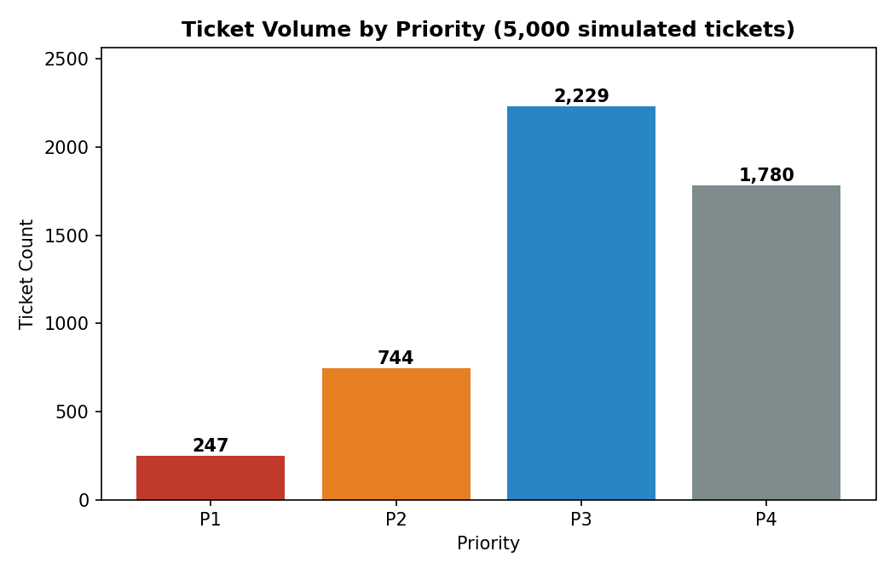
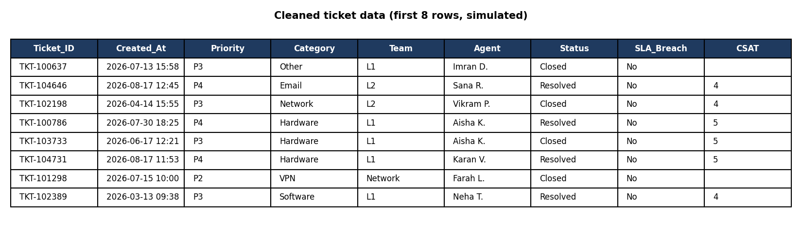

# Helpdesk KPI Dashboard

A Python project that cleans a raw helpdesk ticket export, calculates support KPIs, and presents them in an interactive Streamlit dashboard.

**Stack:** Python · Pandas · Streamlit · Matplotlib

**Live demo:** https://hedesk-dashboard.streamlit.app/

> **Dataset distinction:** The ticket-level dashboard in this repository uses a synthetic practice dataset and does not contain employer or customer data. The separate Montgomery County MCG HelpIT public-data case study uses aggregated government summaries; it does not provide ticket-level IDs, timestamps, SLA targets, agent records, or individual CSAT scores. Do not combine the two datasets or attribute the synthetic ticket KPIs below to the government source. See [public data source notes](docs/public-data-source.md).

---

## Overview

The project turns a messy ticket export into a clean dataset and a set of support metrics:

1,020 raw rows → 1,000 unique, clean tickets → 5 KPIs → interactive dashboard

The raw file intentionally includes 20 duplicate or null rows to practice data-quality cleanup.

## Dataset

`Helpdesk_Tickets_Dataset_1000.xlsx` contains the following fields:

| Field | Description |
|---|---|
| Ticket_ID | Unique ticket identifier |
| Priority | P1 to P4 |
| Category | Ticket category |
| Status | Current ticket status |
| SLA_Breach | Whether the SLA was breached |
| CSAT | Customer satisfaction score, 1 to 5 |
| Is_Repeat | Whether the ticket is a repeat issue |

## KPIs

| KPI | Result |
|---|---|
| SLA adherence | 91.2% (breach rate 8.8%) |
| P1 SLA breach rate | 30%, compared with about 5% for P3/P4 |
| Average CSAT | 3.73 / 5 |
| Repeat ticket rate | 12% |
| Rows kept after cleaning | 98% (1,000 of 1,020) |

## Screenshots





## How to run

```bash
pip install -r requirements.txt
python clean_tickets.py
streamlit run app.py
```

## Project files

| File | Purpose |
|---|---|
| `Helpdesk_Tickets_Dataset_1000.xlsx` | Raw sample ticket export |
| `clean_tickets.py` | Cleaning pipeline: duplicates, nulls, validation |
| `app.py` | Streamlit dashboard |
| `requirements.txt` | Python dependencies |
| `priority_distribution.png`, `table_preview.png` | Output screenshots |

## What I practiced

- Cleaning and validating a messy export with Pandas
- Defining and calculating support KPIs (SLA adherence, CSAT, repeat rate)
- Presenting results in a dashboard for non-technical readers

## Author

**Sajid Manzoor**, Technical Support Engineer
[LinkedIn](https://www.linkedin.com/in/sajid-manzoor-730zz)
